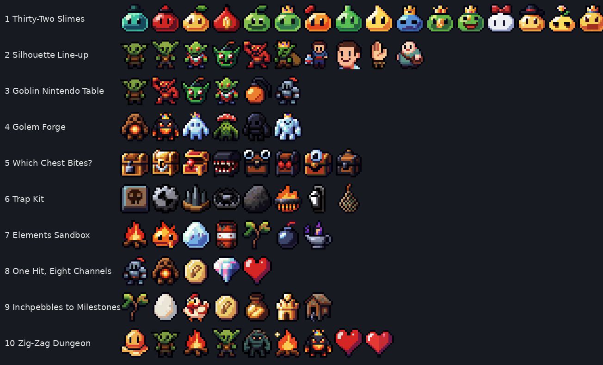

# Pixel Art Atlas × Design Scriptures: 10 pitches

Fun, small things to build with the AI-generated sprite library ([pixel-art-atlas](https://huggingface.co/datasets/Angais/pixel-art-atlas-1.4m): 16×16 CC0 sprites, 6,194 subjects, 32 variants per subject on each sheet), each one teaching a specific entry from the Game Design Scripture.

## What this art offers, and what it lacks

Three facts about the library shaped every pitch:

1. **Every subject comes in 32 variants.** 32 king slimes, 32 goblin archers, 32 mimic chests. Most are palette or accessory swaps. That is a liability for a game, and a gift for teaching depth, variants and the illusion of depth (pitches 1, 2, 4).
2. **One frame per sprite, no animation.** Anything that moves has to be tweened (squash, flash, shake, knockback). That makes feel demos *more* honest, not less: every bit of impact comes from the feedback channels, not the art (pitch 8).
3. **Captions drift.** The "healer" sheet includes a waving hand and a smiling face. Sheets have to be curated by hand, and the drift is itself a usable Clarity lesson (pitch 2).

---

## 1. Thirty-Two Slimes ⭐ flagship

**Scripture:** Entry 15, Celia's Definitive Depth Description (the three circles: possibility space → differentiated depth → relevant depth).

**Sprites:** the slime family: king, fire, ice, acid, bubble, crystal, lava, honey, eyeball and leaf slime sheets.

**What the viewer does.** Starts with all 32 king slimes on a table: "your designer delivered 32 enemies." They drag slimes into piles by *what the player would do differently against it*. Each slime only has a color and a hat, so everything ends up in one pile. The red circle says 32, the orange circle says 1. Then they unlock keyword chips (Splits, Burns, Freezes, Corrodes armor, Heals allies) and stamp them onto slimes. Each new keyword splits a pile, and the orange circle grows. A final step adds a "player loadout" (sword, torch, frost bomb). Slimes the loadout can't tell apart merge back, so the yellow circle (relevant depth) is shown to depend on the player's tools.

**What it proves.** Visual variety is the red circle. A palette swap adds possibility space and zero differentiated depth. Depth comes from *functional* differences that meet the player's verbs. Readout: "32 enemies → 1 play pattern → 5 play patterns."

**Why this art.** The dataset literally delivers the tic-tac-toe problem at scale: 32 apparent options that collapse to one.

---

## 2. Silhouette Line-up ⭐

**Scripture:** Entry 16 (Way of Nintendo, Uniqueness: the silhouette test) and Entry 11 (Alavi: "test with solid black fills"; the source of power should read at once). Entry 2 Clarity.

**Sprites:** goblin, goblin archer, goblin shaman, bomb goblin, goblin brute, goblin king, plus four cells from the "healer" sheet.

**What the viewer does.** A police line-up of six goblins, all shown as solid black fills. A role card is dealt ("Which one shoots from range?", "Which one heals the others?") and the viewer picks. A reveal fades the colour in and scores the read. A second round lets them swap any goblin for another of its 32 variants, hunting for the variant whose silhouette carries its role (the archer whose bow sticks out, the shaman whose staff rises above the head). The bonus round deals four "healers" from the caption-drifted sheet: none of them read as a healer even in full colour.

**What it proves.** At 16×16 the silhouette *is* the whole character. Role has to be carried by a shape that sticks out of the body (bow, staff, bomb, crown). The healer round shows what happens when the label and the image disagree: the player trusts the image.

---

## 3. The Goblin Nintendo Table ⭐

**Scripture:** Entry 16, The Way of Nintendo: Introduce → Escalate → Permutate → Both, and compositional design (movement × response to each player verb).

**Sprites:** knight (player), goblin, goblin brute, bomb goblin, goblin shaman, fire bomb.

**What the viewer does.** A one-screen side-on lane. The knight has three verbs: **Stomp**, **Throw bomb**, **Shield-bash**. Above it sits the response table (rows = goblins, columns = verbs, cells = "dies", "staggers", "immune", "explodes"). The viewer plays four rooms in order:
- **Introduce:** goblin, dies to anything.
- **Escalate:** goblin brute, takes two stomps (same answer, higher stakes).
- **Permutate:** bomb goblin, stomping it detonates on you, so the answer changes to bash it away.
- **Both:** shaman behind a brute, which shields the brute until you throw over it.

Then they can edit any cell of the table and replay. Making every cell "dies" turns all four rooms into the same room, and a counter shows "verbs used: 1 of 3."

**What it proves.** "Enemies exist to make players use all of their mechanics." The table is the design. This is the original-art twin of the Mario enemy table, so it can sit beside the real Super Mario sprites without repeating them.

---

## 4. The Golem Forge

**Scripture:** Entry 20, Xelnath's Compositional Frameworks: Enemy = Archetypes + Creature + Variants (thematic vs mechanical variants).

**Sprites:** clay, magma, ice, moss, obsidian and crystal golem.

**What the viewer does.** Picks two or three archetype chips (Brute, Defender, Zone healer, Sweeper, Hang-back caster) and a golem body. The forge outputs an enemy card with its sprite, keyword payload and one-line behaviour. Then a **Variant** dial with two positions: *Thematic* (swap clay for magma: new palette, same card) and *Mechanical* (magma's aura burns instead of heals, ice's slows). A side panel tallies the cost of each: thematic variants cost an art pass, mechanical ones cost a tutorial line.

**What it proves.** Six bodies × five archetypes is a bestiary, not six enemies. Variants are cheap when they're thematic, and they only add play when they're mechanical, which ties back to pitch 1.

---

## 5. Which Chest Bites?

**Scripture:** Entry 10, Sopko (beginners: the affordance matrix of perceived vs possible; false affordances are troll design, hidden affordances are secrets). Entry 2 Clarity, Entry 3 Predictable Results.

**Sprites:** locked treasure chest, open treasure chest, mimic chest (the sheet runs from obvious teeth to a single subtle eye).

**What the viewer does.** A dungeon room with eight chests. They click to open, and some are mimics. Round 1 has no tells: a mimic with no tell is a **false affordance**, and losing to it teaches nothing. Round 2 adds a **tell slider** that swaps mimic variants from "fang-filled maw" down to "one eye half-open" down to "identical". The viewer tunes it and a meter shows two curves: the share of players who'd catch it on a first visit, and the share who'd catch it after one bite. The sweet spot is a tell you miss once and never miss again.

**What it proves.** A trap is fair when the tell exists and can be learned. It sits in the hidden-affordance cell, not the false one. Response and growth come from the tell, not from the bite.

---

## 6. The Trap Kit

**Scripture:** Entry 16, Environmental hazards: every hazard = **Trigger → Effect → Recovery**; swap any one; the 14 hazard patterns.

**Sprites:** pressure plate, floor lever (triggers); floor spikes, bear trap, boulder, flame jet trap, poison dart trap, net trap (effects).

**What the viewer does.** Three slot-machine reels: Trigger (plate / lever / proximity / timer), Effect (spikes / bear trap / boulder / flame jet / darts / net), Recovery (resets / one-shot / destroyed by player). Each spin builds a hazard and drops it into a short corridor the viewer walks a knight through. A tag shows the hazard pattern it lands in (In Path, Across, Area denial…), and a "lessons" tray collects what each combination teaches. A counter tracks how many distinct hazards the kit can make from 4 + 6 + 3 parts.

**What it proves.** Hazards scale by components, not by one-off builds: 13 parts make 72 hazards. It also shows which combinations repeat a lesson the player already has (a pattern counted as a duplicate).

---

## 7. Elements Sandbox

**Scripture:** Entry 18, Ortho (Versatility, Synergy, Interlocking: oil + fire = burning pool) and Entry 15 Elegance = Depth ÷ Complexity. Entry 20's BotW alchemy note.

**Sprites:** campfire, fire slime, ice slime, hazard barrel, oak sapling, ice bomb, oil lamp.

**What the viewer does.** A small tile grid. The viewer places elements and fires a fire bomb or ice bomb into it. Each element carries 1–3 keywords (Burnable, Freezable, Explosive, Spreads, Melts). Interactions chain: lamp spills oil → fire spreads along it → barrel explodes → sapling burns, while an ice slime freezes the oil path and stops it. A live readout shows **rules learned** (complexity) and **distinct outcomes seen** (depth), and their ratio as the elegance score.

**What it proves.** Five keywords that touch everything make more outcomes than twenty one-off rules. The viewer sees elegance climb when they add an interaction, not when they add an element.

---

## 8. One Hit, Eight Channels

**Scripture:** Entry 6, Jacopian Feedback Theory (8 channels), Entry 7, Rogerian Tactile Design (the interaction timeline), Entry 3 McEntoss (Impact).

**Sprites:** knight, clay golem, coin, gem, heart icon (as particle and pickup sources).

**What the viewer does.** A knight hits a golem, on repeat. Both sprites are a single static frame. The viewer turns on channels one by one: **VFX/Light** (white flash, sparks made from shrunken gem pixels), **Animation/Movement** (tweened lunge and knockback), **Time** (hit-stop, with a frame slider), **Camera** (shake), **SFX**, **UI** (damage number), **2D material** (tint and a crack decal), **Haptics** (`navigator.vibrate` on Android). A timeline strip under the stage labels where each channel fires: Wind-up / Strike / Contact / Discharge / Settle.

**What it proves.** With zero animation frames, the hit can still go from "the numbers changed" to Meaty. That isolates feel as a design job separate from the art budget. Variant: a "too much" preset (all channels at max) to show where Juice turns into noise.

---

## 9. Inchpebbles to Milestones

**Scripture:** Entry 1, Ashuras (milestones / yards / inchpebbles; golden / silver / dirt paths) and Entry 23, Pardo's Paradigm of Pacing (four time scales).

**Sprites:** oak sapling, cracked egg, chicken, coin, bag of gold coins, gold coin tower, chicken coop.

**What the viewer does.** A tiny farm's goal list is laid out on four lanes: seconds, 30-second windows, a 5–15 min session, and day to day. The viewer drags goal tokens (collect an egg, fill a coin bag, build the coop, grow the tree overnight) into lanes. Empty lanes glow as gaps ("nothing to want in the next 30 seconds"). A second view draws three routes to the coop: golden (risky, fast), silver, dirt (safe, slow) with expected times. Removing a route shows which kind of player stalls.

**What it proves.** Goals need to exist at every time scale at once, and progress needs more than one path. Systems in one lane don't replace systems in another.

---

## 10. The Zig-Zag Dungeon

**Scripture:** Entry 22, Felder's Structure of Fun (an oscillating, escalating zig-zag of success and stress) vs constant escalation. Entry 14 (succeed inconsistently).

**Sprites:** acid slime, goblin, goblin archer, cave troll, magma golem (rooms); campfire (rest); heart icons (HP).

**What the viewer does.** Drags 8 room cards into a dungeon order. A stress line plots room by room, with a simulated player's HP shown as hearts. Preset "Ramp" (each room harder) draws a steady climb that ends in a fatigue warning. Preset "Zig-zag" (spike, campfire, higher spike, campfire, boss) draws the sawtooth. A small fatigue meter and a "felt progress" meter compare the two.

**What it proves.** Rising difficulty alone tires players. Release after pressure is what makes the next spike feel like a step up. The shape is something you can draw and tune.

---

## Recommendation

Build **1, 2 and 3** first. They use the most distinctive property of this art (32 variants per subject, tiny silhouettes), and together they form a sequence: *see that variety isn't depth → see what makes a role readable → see how roles become a level*. **8** is the strongest standalone game-feel piece and pairs with the existing hitstun slide.

## Build notes

- **Sync gap (fixed 11 Nov).** The source zip is back in `pixel-art-atlas/source/`, and the 1,438 sheets that were missing (most of s, and t–z) were rebuilt from it, so every subject in `index.json` now has its sheet. Skeleton, spike trap, wolf, sheep and tripwire are all available.
- **Curate cells by hand.** Captions drift, so each pitch should pin specific sheet cells (the preview image above uses hand-picked cells).
- **Rendering.** Draw at integer scales with `image-rendering: pixelated`. All motion is tweened, because the sprites are single frames.
- **Credit.** CC0 needs no attribution, but add a footer: "Sprites: Pixel Art Atlas (Angais, CC0), AI-generated."
- **Wording.** Follow Brazie's Rule on all labels: say "dies", "staggers", "readable", "tell caught on first visit". Don't use "good" or "bad".
